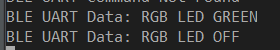
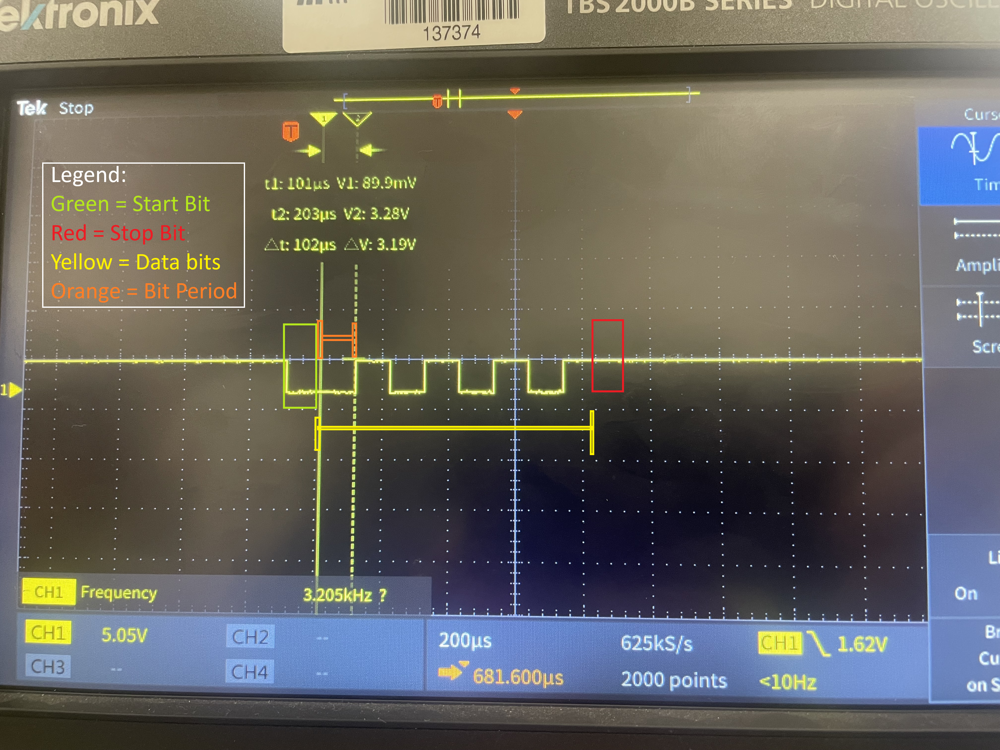
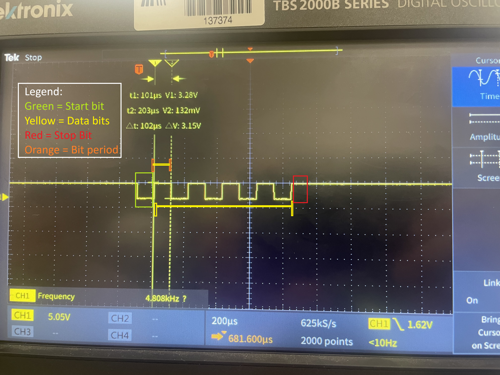
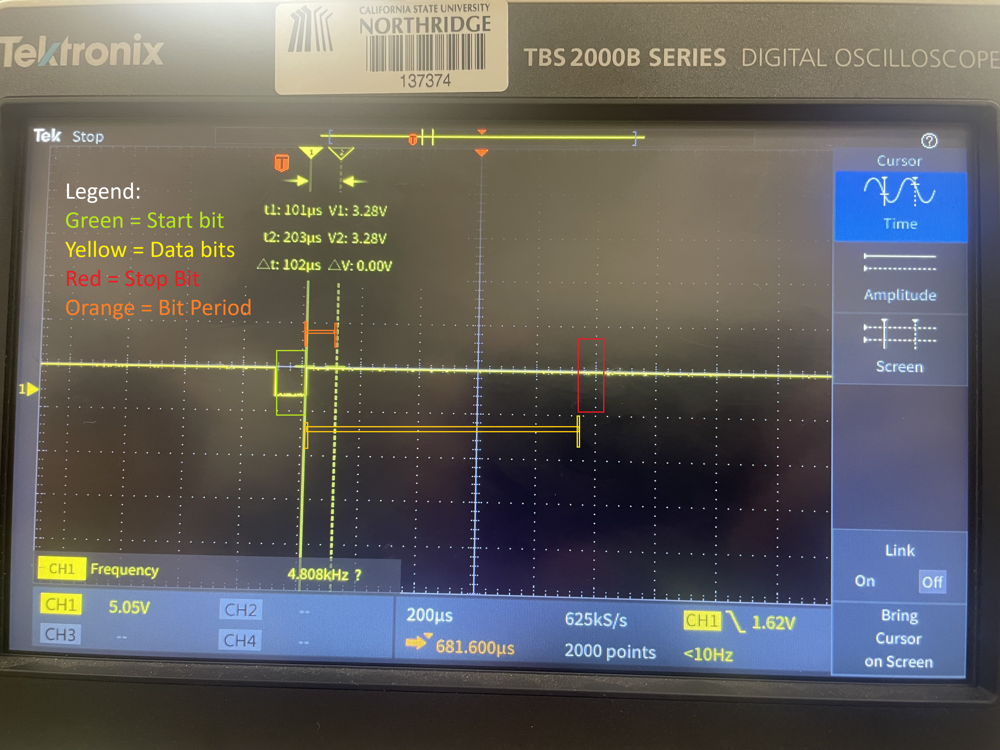
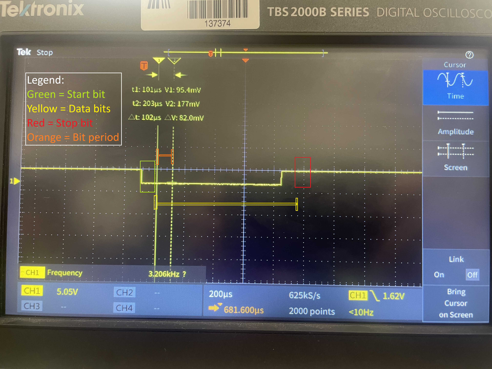
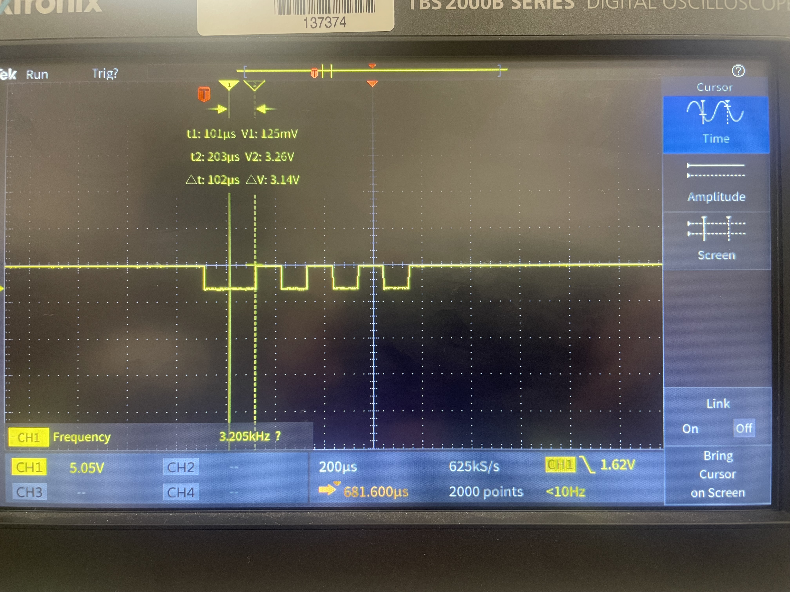
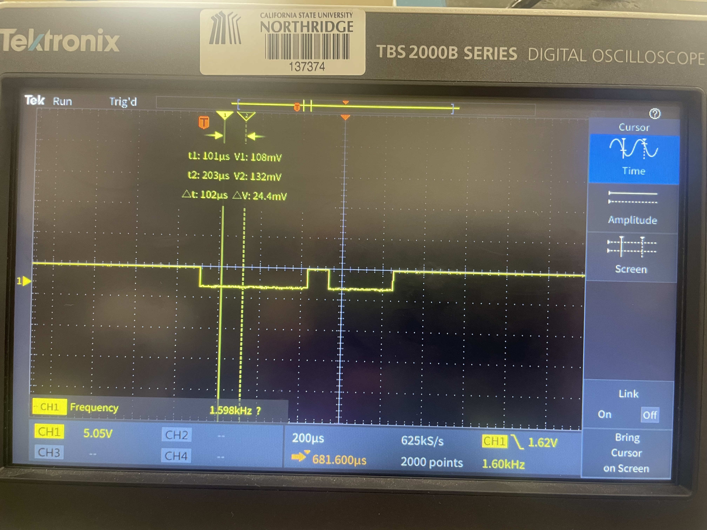
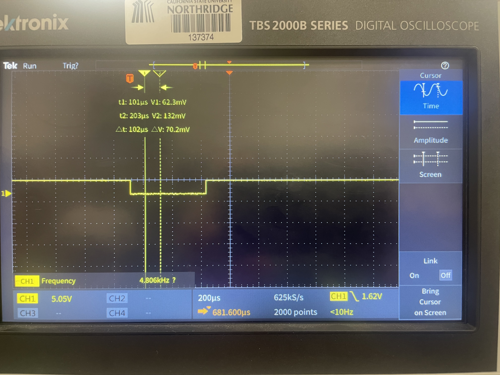
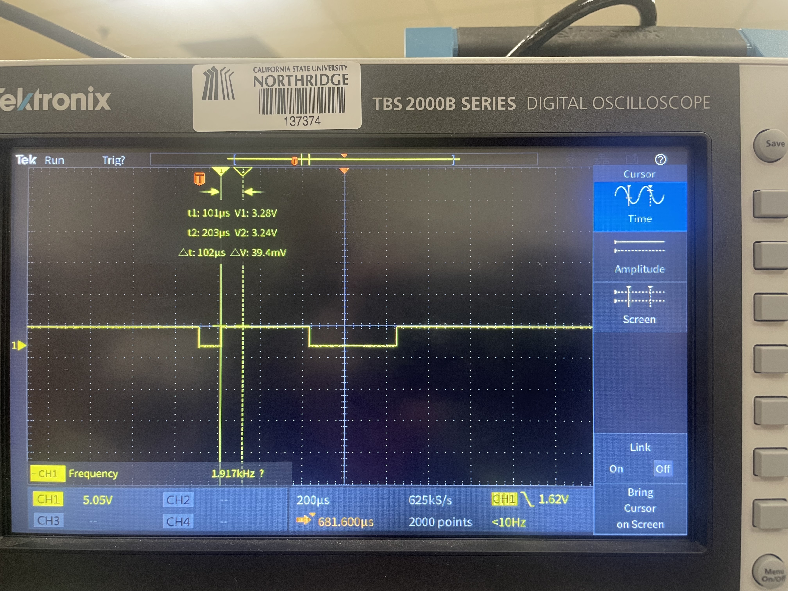
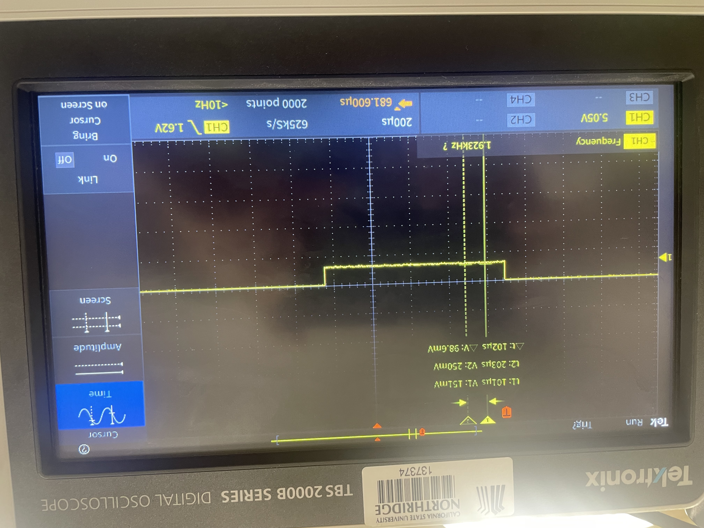

# ECE 528/L - Robotics and Embedded Systems Lab
**CSU Northridge**

**Department of Electrical and Computer Engineering**

## Overview

Title: Lab 4 - Bluetooth Low Energy Lab

Author: Dominic Sanqui

Date: 11/13/26

Description: The purpose of this lab is to integrate an Adafruit Bluefruit LE UART module with the MSP432 Launchpad to transmit and receive UART commands between the robot and a UART application.

## Components Used
- 1 MSP432 Launchpad
- 1 TI-RSLK MAX
- 1 USB-A to Micro-USB Cable
- User LEDs of the TI MSP432 LaunchPad
- Pololu Gearmotor with Encoder - [Product Link](https://www.pololu.com/product/3675)
- Adafruit Bluefruit LE UART Friend - Bluetooth Low Energy (BLE) Module - [Product Link](https://www.adafruit.com/product/2479)

## Prelab

1. What is Bluetooth Low Energy (BLE)? How does it differ from regular Bluetooth in terms of power consumption and range?

BLE is a radio technology that changes frequencies with the 24 GHz band by becoming active for the minimum amount of time needed to transmit data and becoming inactive when no data is transmitted. In contrast, Bluetooth is active the whole time whether or not data needs to be sent. As a result, BLE uses less energy and has a longer battery life than Bluetooth due to the core functionality that it should active for the least amount of time as possible [1].

2. What does GAP stand for and what is its purpose? What is the difference between Peripheral and Central devices in the context of BLE?

Generic Access Profile (GAP) is the model that defines how communication works in Bluetooth. When using Bluetooth, the devices of importance are defined as either a central or peripheral device. Central devices are defined as devices with a high level of processing power. Examples of central devices are computers and smartphones. Peripheral devices are defined as devices that are small and have a very limited battery life. Examples of peripheral devices are heart rate monitors and portable promixity tags. In BLE, a peripheral device would be wireless earbuds that have a limited battery life and low power consumption. The central device in BLE would be a smartphone as it has more processing power than the earbuds [2].

3. What is GATT in BLE, and how does it structure data exchange between connected devices? Provide definitions for the following: Profile, Service, and Characteristic.

Generic Attribute Profile (GATT) is the process for how BLE devices communicate with each other. A peripheral can only connect to one central device at a time, but the central device is able to have connections to multiple peripherals. If data from one peripheral needs to be transmitted from another peripheral, the central device acts as the middle man to facilitate the transaction. This process uses the Attribute Protocol method to store profiles, services, and characteristics in a lookup table with 16-bit IDs per table entry. A characteristic could be considered as a single data point or variable with a unique numeric ID (UUID). Characteristics are the primary source of interaction in BLE. A service is a collection of characteristics and has its own UUID. A profile is a collection of services [3].

4. What is an advertising packet in BLE and what information can it contain?

An advertising packet is a payload that can contain up to 31 bytes of data that is sent from a peripheral device to inform central devices in the area that it is available for a connection. Once the connection between the peripheral and central devices have been established, the peripheral will stop sending advertising packets as it is restricted to one connection at a time. If the peripheral needs to send data to multiple devices, it can circumvent this issue by transmitting data as its payload to any central device in range, but this method is limited to one way communication onl [2].  

5. What is a UUID used for in BLE and why are 128-bit UUIDs used? 

A unique numeric ID (UUID) is used to identify services and characteristics in the GATT communication process. A UUID is typically 16 bits for official BLE services, but it can be 128-bits for custom services. A 128-bit can be used if there is a desire to protect the data or devices. If a company were to create their own UUID, this would ensure that their devices can only be used with that specific UUID. If the company used one of the officially supported UUIDs, then there is a possiblity that their devices could be accessed by another device that knows their UUID [3]. 

6. What bit from which register determines if the UART data is received or transmitted MSB or LSB first? Refer to the eUSCI_A UART Registers section (24.4) of the MSP432P4xx Technical Reference Manual (SLAU356I).

This would be bit 13 (UCMSB) of the CTLW0 register [4].

7. Provide the mnemonic and primary module function for each pin listed. Refer to Table 6-45 (Default Mapping) on page 126 of the MSP432P401R Datasheet.

| PIN  |       Mnemonic         | Input Pin Primary Function | Output Pin Primary Function |
|------|------------------------|----------------------------|-----------------------------|
| P2.2 | PM_UCA1RXD/PM_UCA1SOMI |     eUSCI_A1 UART RXD/eUSCI_A1 SPI SOMI                  |
-------|------------------------|----------------------------------------------------------|
| P2.3 | PM_UCA1TXD/PM_UCA1SIMO |     eUSCI_A1 UART TXD/eUSCI_A1 SPI SIMO                  |
-------|------------------------|----------------------------------------------------------|
| P3.2 | PM_UCA2RXD/PM_UCA2SOMI |     eUSCI_A2 UART RXD/eUSCI_A1 SPI SOMI                  |
-------|------------------------|----------------------------------------------------------|
| P3.3 | PM_UCA2TXD/PM_UCA2SIMO |     eUSCI_A2 UART TXD/eUSCI_A1 SPI SIMO                  |

[5]
8. Write a void function named P2_2_and_P2_3_Init that takes no arguments and configures the following pins to use primary function mode: P2.2 and P2.3. It is not necessary to set the direction of the pins. 

```
void P2_2_and_P2_3_Init(void)
{
    P2->SEL1 &= ~0x0C;
    P2->SEL0 |= 0x0C;
}
```

## Analysis and Results

For this lab, the objective is to integrate the Adafruit BLE UART Module into the MSP432 Launchpad. This will allow the Launchpad transmit and receive commands to and from the UART module. For the tasks that require the Launchpad to transmit commands to the UART module, the signals will be read and graphed by an oscilloscope to demonstrate the functionality of the eUSCI module in the Launchpad. For the tasks that require the Launchpad to receive commands from the UART module, these commands can turn on the LEDs or move the motors of the robot.

The first step in this lab is to follow the steps listed in the procedure section to integrate the UART module to send commands to the Launchpad to turn on or off its RGB LED. First, all of the modules such as the LEDs, motors, UART module, switches, interrupts, and eUSCI UART module will need to be initialized. Next, an array of the character type called BLE_UART_Buffer is initialized which will be used to store the data received from the UART module. Afterwards, the Launchpad transmits a message to the UART module to check that a connection has been made. This can be confirmed by seeing that the LED on the UART module is blue. The last step in the initialization process is the declaration of the uint8_Choose_Operation variable. This variable is set before programming the robot to allow the user to choose if the robot should perform the operations listed in the procedure section, task 1, or task 2. This is to ensure that the robot does not get confused as the different functionalities of each of the tasks is difficult to reconcile.

Once the initialization process is complete, the next step in the procedure section is to transmit commands from the UART module to the Launchpad to turn on or off the RGB LED. First, the eUSCI module waits until the receive interrupt flag is triggered. This flag informs the module that data from the UART module has been transmitted to the Launchpad and is ready to be retrieved. If the data in the receive buffer is not the line feed character which indicates that the data transmission is completed, the data is stored into BLE_UART_Buffer. Once the line feed character has been received, the Launchpad will print the message received from the UART module in the serial terminal. If the message is correct, the Launchpad will either turn on or off the RGB LED. The proof that the functionality works is shown in Figure 1 which captures the output from the serial terminal from Code Composer Studio.

Figure 1: Procedure Section Serial Terminal Output



Although the process seems simple in practice, it was somewhat difficult to understand on paper how the data moves from the UART module to the Launchpad. This is only possible because each individual character in the phrase "RGB LED GREEN" received from the UART module is transmitted one at a time to the Launchpad. This leads to the assumption that the Launchpad is using the Clear to Send (CTS) control pin of the UART module to inform the module to send only one character a time. It's difficult to understand how the Launchpad knows how to do this especially when it's time to develop the code for Task 2, because the current code does not have any lines to clear or set this bit as its always set to ground. This would mean that the UART module is constantly sending data to the Launchpad which should make it impossible to detect when a byte starts or ends but the results from this section show that it is possible. 

Additionally, it took a lot of time to understand how the reading and storing of the data received from the UART module worked. Currently, the understanding is that the pointer of BLE_UART_Buffer is fed into the BLE_UART_Instring function that is responsible for reading the data from the UART module for this section. This allows the function to have both the array to store the data in and the index of the array to write data into. It took time to distinguish the difference between *buffer_pointer acting as the array and buffer_pointer acting as the index.

Now that the procedure is complete, the next part of the lab is to complete task 1. This is divided into two parts. Part A of task 1 is to program the Launchpad to transmit several bytes of data and analyze them with an oscilloscope. Part B of task 1 is to use the PMOD switch to transmit different bytes of data based on the value of the switch and analyze them with an oscilloscope. 

To perform task 1, the uint8_Choose_Operation variable is set to a value of 2 to select that logic. Then, the Launchpad checks for the value of the PMOD switches. Next, the value of the switch is fed into the PMOD_SWT_and_UART_Process function. The Launchpad will then transmit data based on the value of the switches. For the sake of simplicity, switch value 0x00 has been assigned to transmit data corresponding to part A and the remainder of the function has been assigned to transmit data corresponding to part B.

The results of task 1 can be seen in Figures 2-10. Figures 2-5 are the results from part A to transmit bytes 0xAA, 0x55, 0xFF, and 0x00 respectively. These figures have the start bit, data bits, stop bit, bit period, and bit duration labeled with a specific color. Green indicates the start bit, yellow indicates the data bits, red indicates the stop bit, and orange indicates the bit period. Since the eUSCI module was configured to transmit the LSB first, these figures confirm that the Launchpad is sending the data bits in the correct order. For example, transmitting 0xAA from LSB to MSB means that the data bits start with the value of 0 at bit 0 and toggle until bit 7 which is 1. In contrast, transmitting 0x55 from LSB to MSB means that the data bits start with the value of 1 at bit 1 and toggle until bit 7 which is 0. From each figure, the bit duration is noted to be 101 us. Using the formula to calculate the bit duration which is (1 / baud rate), this would be (1 / 9600) which equates to 104 ns. The bit duration depicted in these figures is approximately correct, so this confirms that the Launchpad is transmitting data with the correct pattern and bit duration.

Figure 2: Part A Byte 0xAA




Figure 3: Part A Byte 0x55




Figure 4: Part A Byte 0xFF




Figure 5: Part A Byte 0x00




The results of part B of task 1 are shown in Figures 6-10 which are the bytes 0xAA, 0x10, 0xF0, 0x0F, and 0x00 respectively. Just like Figures 2-5, the Launchpad is transmitting the bytes in the correct bit pattern. Since Figures 2-10 have been verified to have the correct bit pattern, task 1 has been completed.

Figure 6: Part A Byte 0xAA



Figure 7: Part A Byte 0x10



Figure 8: Part A Byte 0xF0



Figure 9: Part A Byte 0x0F



Figure 10: Part A Byte 0x00



Now that task 1 has been completed, the final section for this lab is to complete task 2. For this task, the robot will need to be programmed to accept directional values from the UART module to move the robot left, right, forward, backward, or to stop. First, the uint8_Choose_Operation variable is set to 2 to tell the robot to use the logic written for task 2. Next, a new function called BLE_UART_InPacket is called and provided the BLE_UART_Buffer array to store the values transmitted from the UART module to the Launchpad. This function will first wait until the '!' symbol is received from the UART module which indicates the start of a directional instruction. Once this symbol has been received, it and 4 additional data bytes are stored to the BLE_UART_Buffer array. 

Then, the new function Decode_Controller_Packet is called and given the BLE_UART_Buffer array that contains all of the bytes used by the UART module to indicate a directional instruction. This function will first confirm that the first byte in the array is the '!'. The function will then confirm that the second byte in the array is the 'B' symbol. If neither of these conditions are fulfilled, the data will be ignored and the Launchpad will go back to waiting for a new data transmission. Then, the third and fourth data bytes are read. If the third data byte is 0, then the Launchpad will stop the motors. If the third data byte is 1, then the Launchpad checks the value of the fourth data byte. Based on this symbol, the Launchpad will tell the motors to move forward, left, right, or backwards. For all of these states, LED1 and LED2 may be turned on to indicate the state that the robot is in to support debugging. There are no results to show for this section, because it is a demonstration to the professor.

This section was difficult to complete, because there was confusion on the values that the UART module transmits. The original code implementation was to check for the hex values of the symbols, but the debugger showed that the values were not picked up at all. This lead to confusion, because there was a concern that the only data packets that the UART module sent was just the '!' symbol and direction character. After reworking the code to check for the symbols directly and this resulted in a successful operation for the robot to move around. 

## Known Issues or Limitations

N/A

## References

[1] B. Proctor, “Bluetooth vs. Bluetooth Low Energy: What’s the difference?: Blog,” Link Labs, https://www.link-labs.com/blog/bluetooth-vs-bluetooth-low-energy (accessed Nov. 15, 2026). 

[2] K. Townsend, “Introduction to bluetooth low energy,” Adafruit Learning System, https://learn.adafruit.com/introduction-to-bluetooth-low-energy/gap (accessed Nov. 15, 2026). 

[3] K. Townsend, “Introduction to bluetooth low energy,” Adafruit Learning System, https://learn.adafruit.com/introduction-to-bluetooth-low-energy/gatt (accessed Nov. 15, 2026). 

[4] Technical Reference Manual for TI MSP432 Launchpad
[Product Link](https://web.archive.org/web/20200402132841/http:/www.ti.com/lit/ug/slau356i/slau356i.pdf)

[5] Technical Document for MSP432 
[Product Link](https://www.ti.com/lit/ds/slas826e/slas826e.pdf)